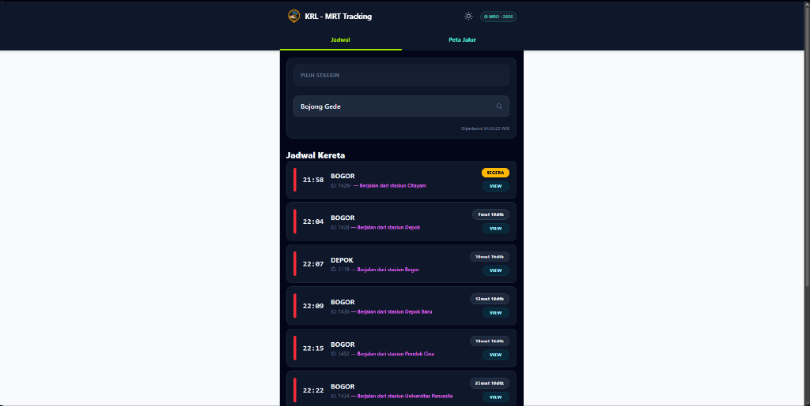
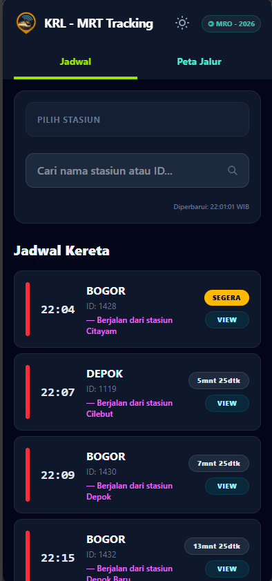
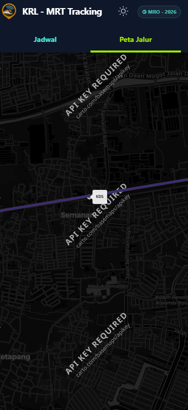

<p align="center">
  
</p>

<h1 align="center">🚇 Jakarta KRL - MRT Tracking Webapp</h1>

<p align="center">
  <strong>Aplikasi pelacak jadwal dan rute kereta komuter (KRL Commuter Line & MRT Jakarta) berbasis web secara real-time dengan visualisasi peta interaktif dan navigasi cerdas.</strong>
</p>

<p align="center">
  
  
  
  
  
  
  
</p>

<p align="center">
  <a href="#-preview--screenshot">Preview</a> •
  <a href="#-fitur-utama">Fitur Utama</a> •
  <a href="#-panduan-penggunaan">Panduan Penggunaan</a> •
  <a href="#-teknologi-yang-digunakan">Teknologi</a> •
  <a href="#-cara-instalasi--menjalankan">Instalasi</a> •
  <a href="#-struktur-proyek">Struktur Proyek</a>
</p>

---

## 📸 Preview & Screenshot

Berikut adalah visualisasi antarmuka webapp pada berbagai skenario penggunaan:

### 1. Dashboard Desktop (Tampilan Penuh 2 Kolom)
Tampilan layar desktop yang luas dengan layout dua kolom: pencarian stasiun di sisi kiri (sticky) dan feed jadwal keberangkatan di sisi kanan.

<p align="center">
  
</p>

---

### 2. Tampilan Mobile & Peta Jalur (Line Map)
Didesain mobile-first yang responsif serta integrasi peta rute dan pelacak posisi kereta aktif secara presisi.

<table align="center" width="100%">
  <tr>
    <td width="50%" align="center">
      <strong>📱 Tampilan Jadwal Mobile</strong>
    </td>
    <td width="50%" align="center">
      <strong>🗺️ Tampilan Peta Jalur & Marker Stasiun</strong>
    </td>
  </tr>
  <tr>
    <td align="center">
      
    </td>
    <td align="center">
      
    </td>
  </tr>
</table>

---

## ✨ Fitur Utama

- **⏱️ Live Countdown Jadwal Kereta**:
  Menampilkan jadwal keberangkatan kereta mendatang lengkap dengan hitungan mundur waktu nyata (*minutes & seconds countdown*).
- **📍 Snap-to-Track Geospatial (Turf.js)**:
  Posisi kereta yang sedang berjalan diinterpolasikan dan di-*snap* secara otomatis ke koordinat jalur rel sebenarnya dari data GeoJSON sehingga pergerakan di peta tampak presisi dan tidak melenceng.
- **🎯 Fitur Fly-to-Train ("VIEW")**:
  Cukup klik tombol **"VIEW"** pada kartu jadwal kereta untuk otomatis berpindah ke tab peta dan melakukan zoom/kamera terbang (*flyTo*) langsung ke lokasi kereta yang bersangkutan.
- **🧭 Auto-Detect Stasiun Terdekat**:
  Memanfaatkan sensor *Browser Geolocation API* untuk langsung memilih stasiun KRL atau MRT terdekat dari lokasi Anda saat membuka webapp.
- **🖥️ Tata Letak Responsif Adaptif**:
  - **Desktop**: Tampilan lebar penuh (*full-screen*) modern berbentuk dashboard split 2 kolom.
  - **Mobile**: Tampilan vertikal satu kolom yang nyaman dioperasikan dengan satu tangan.
- **🌓 Mode Terang & Gelap (Dark Mode)**:
  Mendukung pergantian tema instan yang juga secara otomatis mengubah tema *tile basemap* Leaflet (Carto Positron / Carto Dark Matter).
- **🚆 Dukungan Lintas Moda (KRL & MRT)**:
  Mencakup seluruh jalur Commuter Line Jabodetabek (Bogor, Cikarang, Rangkasbitung, Tangerang, Tanjung Priok) serta jalur MRT Jakarta (Lebak Bulus - Bundaran HI).
- **⚡ Super Cepat & Ringan**:
  Dibangun dengan **Svelte 5 Runes** untuk reaktivitas state berkecepatan tinggi tanpa overhead virtual DOM.

---

## 📖 Panduan Penggunaan

Panduan langkah demi langkah menggunakan webapp KRL - MRT Tracking:

```
+---------------------------------------------------------------------------------+
|                                 CARA MENGGUNAKAN                                |
+-----------------------+-----------------------+---------------------------------+
| 1. Pilih Stasiun      | 2. Pantau Jadwal      | 3. Lacak di Peta                |
| Ketik nama/kode stasiun| Cek status (Tiba,     | Klik tombol 'VIEW' untuk zoom   |
| atau izinkan GPS Anda.| Segera, atau hitungan)| ke posisi kereta di jalur rel.  |
+-----------------------+-----------------------+---------------------------------+
```

### 1. Memilih Stasiun Kereta
1. Pada kartu **Pilih Stasiun**, klik kolom pencarian bertuliskan *"Cari nama stasiun atau ID..."*.
2. Ketik nama stasiun (contoh: `Manggarai`, `Bojong Gede`, `Sudirman`) atau kode stasiun 3-4 huruf (contoh: `MRI`, `BJD`, `DKA`).
3. Klik salah satu stasiun dari daftar dropdown yang muncul.
4. *Tips:* Jika Anda mengizinkan akses lokasi pada browser, aplikasi akan otomatis memilihkan stasiun yang terdekat dengan posisi Anda saat ini.

### 2. Membaca Status Jadwal Kereta
Setiap kartu kereta menampilkan indikator warna garis di sebelah kiri sesuai jalurnya:
- 🔴 **Merah**: Jalur Bogor (Bogor Line)
- 🔵 **Biru**: Jalur Cikarang (Cikarang Loop Line)
- 🟢 **Hijau**: Jalur Rangkasbitung
- 🟤 **Cokelat**: Jalur Tangerang
- 🌸 **Merah Muda**: Jalur Tanjung Priok
- 🔷 **Biru Tua**: MRT Jakarta

**Status Keberangkatan:**
- **`TIBA`** (Lencana Cyan): Kereta sudah masuk ke peron stasiun yang dipilih.
- **`SEGERA`** (Lencana Kuning): Kereta berada dalam waktu kurang dari 5 menit menuju stasiun.
- **`XXmnt XXdtk`** (Lencana Abu-abu): Waktu hitung mundur menuju jadwal kedatangan kereta.
- **Teks Tambahan Ungu**: Menampilkan stasiun asal dan stasiun sebelumnya jika kereta sedang dalam perjalanan aktif.

### 3. Melacak Kereta di Peta
1. Pada kartu kereta yang diinginkan, klik tombol **"VIEW"**.
2. Webapp akan otomatis berpindah ke tab **Peta Jalur**.
3. Peta akan melakukan animasi meluncur (*smooth flyTo*) dan membuka *popup* informasi kereta tersebut (Nomor KA, Jalur, Tujuan, dan segmen stasiun yang sedang dilalui).

### 4. Beralih Antara Mode Terang & Gelap
- Klik ikon matahari ☀️ / bulan 🌙 pada bilah navigasi atas (kanan atas) untuk mengganti mode visual. Peta dan seluruh komponen akan otomatis menyesuaikan kontras warna.

---

## 🛠️ Teknologi yang Digunakan

| Kategori | Teknologi | Kegunaan |
| :--- | :--- | :--- |
| **Frontend Framework** | [Svelte 5](https://svelte.dev/) | Framework komponen reaktif modern menggunakan Svelte Runes (`$state`, `$derived`, `$effect`). |
| **Meta-Framework** | [SvelteKit 2](https://kit.svelte.dev/) | SSR, file-based routing, dan server endpoint API. |
| **CSS & Styling** | [Tailwind CSS v4](https://tailwindcss.com/) | Utility-first CSS framework untuk tampilan responsif. |
| **Peta Interaktif** | [Leaflet](https://leafletjs.com/) | Rendering peta interaktif, marker stasiun, dan posisi kereta. |
| **Geospatial Engine** | [Turf.js](https://turfjs.org/) | Algoritma perhitungan matematis spasial dan *snap-to-line*. |
| **Basemap Provider** | [CARTO Basemaps](https://carto.com/basemaps/) | Peta raster tile Carto Light Positron & Dark Matter. |
| **Scraper** | [Puppeteer](https://pptr.dev/) | Otomatisasi browser untuk scraping jadwal MRT Jakarta. |
| **Build Tool** | [Vite 8](https://vite.dev/) | Bundler aset super cepat dengan HMR (*Hot Module Replacement*). |

---

## 🚀 Cara Instalasi & Menjalankan

### Prasyarat
- [Node.js](https://nodejs.org/) (versi 18.x atau yang lebih baru disarankan)
- Package manager `npm`, `pnpm`, atau `yarn`

### 1. Clone Repositori
```bash
git clone https://github.com/oktavianrizalm/TrackingKRL.git
cd TrackingKRL
```

### 2. Instal Dependensi
```bash
npm install
```

### 3. Jalankan Server Pengembangan (Dev)
```bash
npm run dev
```
Buka browser dan akses alamat:
```
http://localhost:5173
```

### 4. Build untuk Lingkungan Produksi
Untuk menguji hasil kompilasi produksi:
```bash
npm run build
npm run preview
```

### 5. Memperbarui Data Jadwal MRT (Opsional)
Jika ingin mengambil data jadwal terbaru dari situs resmi MRT Jakarta:
```bash
node scrape-mrt.cjs
```
Skrip ini akan mengambil data jadwal dari web MRT dan menyimpannya ke `static/mrt-schedule.json` dan `static/mrt-stations.json`.

---

## ⚙️ Cara Kerja Sistem Pelacakan Real-Time

```
  +--------------------+        +---------------------+
  |  Jadwal Resmi      |        |  Waktu Server       |
  |  (GAPEKA & MRT)    |        |  (Asia/Jakarta)     |
  +---------+----------+        +----------+----------+
            |                              |
            +-------------->+<-------------+
                            |
                 [Filter Kereta Aktif]
              (Mencari kereta yang sedang
                 berjalan antar stasiun)
                            |
                            v
            [Interpolasi Progress Waktu]
            (Menghitung % jarak antar stasiun)
                            |
                            v
           [Geospatial Snapping (Turf.js)]
        (Snap koordinat ke garis rel GeoJSON)
                            |
                            v
           [Leaflet Circle Marker Map Update]
          (Diperbarui setiap 5 detik di klien)
```

1. **Sinkronisasi Waktu**: Server membaca waktu saat ini di zona waktu `Asia/Jakarta`.
2. **Kalkulasi Kereta Aktif**: Backend menyaring seluruh jadwal kereta untuk mendeteksi kereta mana yang waktu keberangkatannya sudah lewat dari stasiun asal namun belum tiba di stasiun akhir.
3. **Interpolasi Posisi**: Berdasarkan selisih waktu keberangkatan dan kedatangan pada segmen stasiun yang sedang ditempuh, sistem menghitung persentase progres ($0.0 - 1.0$).
4. **Snapping Jalur (Turf.js)**: Posisi linear kereta di-proyeksikan ke garis geometri rel terdekat menggunakan fungsi `nearestPointOnLine` dari `@turf/nearest-point-on-line`.
5. **Update Frontend**: Leaflet marker diperbarui secara mulus setiap 5 detik.

---

## 📂 Struktur Proyek

```text
TrackingKRL/
├── docs/
│   └── screenshots/              # Gambar screenshot dokumentasi webapp
│       ├── desktop-schedule.png
│       ├── mobile-schedule.png
│       └── map-view.png
├── src/
│   ├── lib/
│   │   ├── assets/               # Aset ikon dan logo lokal
│   │   ├── mapData.ts            # Daftar koordinat stasiun, warna jalur, dan mapping ID
│   │   └── server/
│   │       └── mockSchedule.ts   # Parser data jadwal KRL & MRT terpadu
│   └── routes/
│       ├── api/
│       │   ├── active-trains/    # Endpoint API: kalkulasi posisi kereta aktif
│       │   ├── stations/         # Endpoint API: daftar seluruh stasiun
│       │   └── trains/           # Endpoint API: jadwal kereta per stasiun
│       ├── +layout.svelte        # Shell layout utama
│       └── +page.svelte          # Halaman utama aplikasi (Jadwal + Peta)
├── static/
│   ├── all-stations.json         # Database koordinat seluruh stasiun
│   ├── krl-routes.geojson        # Geometri garis rel KRL & MRT Jakarta
│   ├── logo.png                  # Logo utama aplikasi
│   ├── mrt-schedule.json         # Data jadwal MRT hasil scraping
│   ├── mrt-stations.json         # Daftar stasiun MRT
│   └── schedule.json             # Data jadwal KRL Commuter Line
├── scrape-mrt.cjs                # Puppeteer scraper untuk MRT Jakarta
├── package.json                  # Konfigurasi dependensi dan scripts
└── vite.config.ts                # Konfigurasi bundler Vite
```

---

## 🗺️ Catatan Konfigurasi Basemap (CARTO API Key)

Aplikasi ini menggunakan basemap tile dari CARTO. Sejak pembaruan kebijakan CARTO 2026, pemanggilan tile memerlukan API Key gratis agar tidak menampilkan watermark *"API KEY REQUIRED"*.

API Key sudah terkonfigurasi di `src/routes/+page.svelte`. Jika Anda ingin menggantinya dengan key Anda sendiri:
1. Daftarkan key gratis di [carto.com/basemaps/apikey](https://carto.com/basemaps/apikey).
2. Perbarui variabel `cartoApiKey` pada baris inisialisasi tile Leaflet di `src/routes/+page.svelte`.

---

## 📄 Lisensi & Kredit

- **Pengembang**: Dirancang dan dikembangkan oleh **MRO - 2026**.
- **Sumber Data**: Data jadwal diolah berdasarkan GAPEKA KAI Commuter dan situs resmi MRT Jakarta.
- **Peta Dasar**: &copy; [OpenStreetMap](https://www.openstreetmap.org/copyright) contributors, &copy; [CARTO](https://carto.com/attributions).
