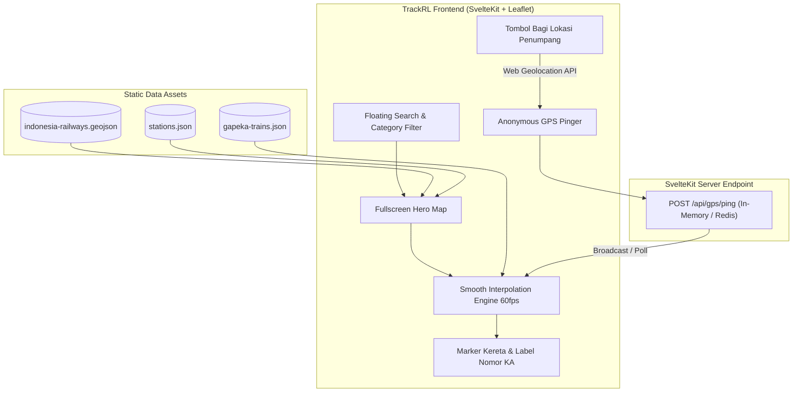

# Playbook: Mengembangkan TrackRL Menjadi "Flightradar24 Kereta Api Indonesia"
*(Panduan Transformasi TrackRL Menuju Fitur Penuh 168Railway Tanpa Paywall & Registrasi)*

---

## 1. Visi & Filosofi Produk

| Aspek | 168Railway (Asli) | TrackRL v2 (Target Kita) |
| :--- | :--- | :--- |
| **Akses Fitur** | Freemium (Banyak kereta dibatasi paywall / "Sahabat 168") | **100% Gratis & Terbuka untuk Semua Pengunjung** |
| **Otentikasi** | Wajib Login untuk melihat seluruh kereta & live GPS | **Zero Friction: Tanpa Login / Tanpa Akun** |
| **Cakupan** | KRL + Antarkota + Whoosh + Lokal | **Nasional Penuh (Jawa, Sumatera, Whoosh, KRL)** |
| **Simulator Game** | Ada PPKA Simulator 2D/3D (berat & butuh aset besar) | **Ditiadakan** (fokus 100% ke real-time tracking cepat & ringan) |
| **Live Telemetri** | Crowdsource GPS Penumpang (wajib login) | **Crowdsource GPS Anonim 1-Klik Langsung dari Browser** |

---

## 2. Temuan Kunci Hasil Reverse-Engineering 168Railway

Dari hasil reverse-engineering terhadap `168railway.com` menggunakan REA, ini rahasia teknis cara kerja mereka yang wajib direplikasi di TrackRL:

1. **Bukan Satelit Langsung dari Gerbong**: Mayoritas kereta bergerak menggunakan **Dead Reckoning Simulation** (interpolasi matematika selisih waktu saat ini terhadap tabel jadwal tiba & berangkat stasiun).
2. **Formula Geodesic**: Menghitung jarak segmen rel menggunakan formula **Haversine** ($R = 6371\text{ km}$) dan memetakan titik koordinat kereta tepat di atas polyline rel GeoJSON.
3. **Overnight Trains Handling**: Kereta yang melintasi tengah malam diberi offset waktu $+86.400.000\text{ ms}$ ($+24\text{ jam}$) agar marker tidak melompat mundur saat pergantian hari.
4. **Tile Layer Rel Khusus**: Menggunakan layer **OpenRailwayMap** di atas basemap satelit/gelap agar jalur rel, sinyal, dan percabangan terlihat kontras.
5. **Dual Mode GPS**:
   * Mode Default: Kereta berjalan otomatis mengikuti jadwal GAPEKA.
   * Mode Live: Jika ada penumpang di kereta tersebut yang menyalakan tombol *"Bagi Lokasi"*, koordinat GPS riil menggantikan simulasi jadwal dan marker berubah warna (*glowing badge*).

---

## 3. Arsitektur Target TrackRL (SvelteKit)



---

## 4. Langkah-Langkah Implementasi (Action Plan)

### Langkah 1: Ubah Layout Menjadi "Map-First" (Fullscreen UX)
Di TrackRL saat ini, pengguna harus berpindah antara tab *Jadwal* dan *Peta*. Ubah paradigma menjadi peta layar penuh:
* **Peta selalu terlihat 100vw x 100vh**.
* **Floating Header**: Bilah pencarian melayang di atas peta (cari stasiun atau nomor kereta).
* **Category Pill Filter**: Tombol kapsul melayang untuk memfilter jenis kereta: `Semua` | `Antarkota` | `KRL` | `Whoosh` | `Bandara`.
* **Bottom Sheet / Sidebar Drawer**: Saat stasiun atau marker kereta diklik, panel detail muncul dari bawah (mobile) atau samping kiri (desktop) tanpa menutup peta.

---

### Langkah 2: Tambahkan Layer Basemap Lengkap & OpenRailway
Gunakan konfigurasi tile layer Leaflet berikut di SvelteKit Anda:

```javascript
// Layer Peta yang bisa dipilih pengguna
const mapLayers = {
  dark: L.tileLayer('https://{s}.basemaps.cartocdn.com/dark_all/{z}/{x}/{y}{r}.png', {
    maxZoom: 19,
    attribution: '&copy; CartoDB & OpenStreetMap'
  }),
  satellite: L.tileLayer('https://server.arcgisonline.com/ArcGIS/rest/services/World_Imagery/MapServer/tile/{z}/{y}/{x}', {
    maxZoom: 19,
    attribution: '&copy; ESRI'
  }),
  // Layer Khusus Jalur Rel Kereta Api Dunia (Transparan, dipasang di atas satelit/dark)
  railway: L.tileLayer('https://{s}.tiles.openrailwaymap.org/standard/{z}/{x}/{y}.png', {
    maxZoom: 19,
    opacity: 0.85,
    attribution: '&copy; OpenRailwayMap'
  })
};
```

---

### Langkah 3: Ekstraksi Data Jalur Rel & Stasiun Nasional (GeoJSON)
Gunakan **Overpass API** untuk mengunduh seluruh jalur rel dan stasiun aktif di Pulau Jawa & Sumatera dari OpenStreetMap.

**Query Overpass (Buka di [overpass-turbo.eu](https://overpass-turbo.eu/)):**
```sparql
[out:json][timeout:90];
// Ambil jalur rel utama di area Indonesia
(
  way["railway"="rail"]["usage"="main"](-9.0, 95.0, -5.0, 115.0);
  way["railway"="rail"]["highspeed"="yes"](-9.0, 95.0, -5.0, 115.0);
  node["railway"="station"](-9.0, 95.0, -5.0, 115.0);
);
out body;
>;
out skel qt;
```
*Export hasil query tersebut menjadi file `static/data/indonesia-railway.geojson` di project TrackRL Anda.*

---

### Langkah 4: Terapkan Engine Interpolasi Gerak Halus (Smooth Interpolation)
Gantikan pembaruan melompat per 5 detik dengan animasi halus kontinu menggunakan `requestAnimationFrame`:

```javascript
// Logika interpolasi posisi kereta di Svelte
function calculateTrainPosition(train, currentTimeMs) {
  const { paths, depart_ms, arriv_ms } = train;
  
  // 1. Cek apakah kereta sedang aktif di rentang jam sekarang
  if (currentTimeMs < depart_ms || currentTimeMs > arriv_ms) return null;

  // 2. Cari stasiun asal dan stasiun tujuan saat ini
  for (let i = 0; i < paths.length - 1; i++) {
    const currentStop = paths[i];
    const nextStop = paths[i + 1];

    // Jika kereta sedang berhenti di stasiun
    if (currentTimeMs >= currentStop.arriv_ms && currentTimeMs <= currentStop.depart_ms) {
      return {
        lat: currentStop.lat,
        lng: currentStop.lng,
        status: 'stopped',
        stationName: currentStop.name
      };
    }

    // Jika kereta sedang bergerak di antara dua stasiun
    if (currentTimeMs > currentStop.depart_ms && currentTimeMs < nextStop.arriv_ms) {
      const travelDuration = nextStop.arriv_ms - currentStop.depart_ms;
      const elapsed = currentTimeMs - currentStop.depart_ms;
      const progress = Math.max(0, Math.min(1, elapsed / travelDuration));

      // Interpolasi koordinat (LERP sederhana atau ikuti polyline rel)
      const lat = currentStop.lat + (nextStop.lat - currentStop.lat) * progress;
      const lng = currentStop.lng + (nextStop.lng - currentStop.lng) * progress;

      return {
        lat,
        lng,
        status: 'moving',
        nextStation: nextStop.name,
        progress
      };
    }
  }
  return null;
}
```

---

### Langkah 5: Desain Marker Kereta Bergaya Radar
Buat marker kustom dengan `L.divIcon` yang menampilkan label nomor kereta dan animasi status:

```javascript
function createTrainIcon(train, isLiveGps = false) {
  const isStopped = train.status === 'stopped';
  const pulseClass = isStopped ? 'animate-pulse ring-4 ring-amber-400' : '';
  const gpsBadge = isLiveGps ? '<span class="bg-emerald-500 text-[9px] px-1 rounded font-bold">LIVE</span>' : '';

  return L.divIcon({
    className: 'custom-train-marker',
    html: `
      <div class="flex items-center gap-1.5 cursor-pointer">
        <div class="w-6 h-6 rounded-full bg-blue-600 border-2 border-white shadow-lg flex items-center justify-center text-white text-xs ${pulseClass}">
          🚄
        </div>
        <div class="bg-slate-900/90 text-white text-[11px] font-bold px-2 py-0.5 rounded shadow flex items-center gap-1">
          <span>${train.number}</span>
          ${gpsBadge}
        </div>
      </div>
    `,
    iconSize: [80, 24],
    iconAnchor: [12, 12]
  });
}
```

---

### Langkah 6: Fitur Crowdsource GPS Anonim (Tombol "Bagi Lokasi")
Buat komponen tombol melayang di pojok kanan bawah:
1. Pengguna klik **"Lagi di Kereta? Bagi Lokasi"**.
2. Browser meminta izin akses lokasi via `navigator.geolocation.watchPosition()`.
3. Client mengirimkan koordinat ke endpoint backend SvelteKit:
   ```javascript
   POST /api/gps/ping
   Body: { lat: -6.210, lng: 106.845, speed: 65, heading: 92 }
   ```
4. Server mencocokkan koordinat dengan kereta terdekat dalam radius $\le 50\text{ meter}$ dari rel.
5. Posisi kereta tersebut langsung diperbarui sebagai **LIVE GPS** untuk semua pengguna.

---

## 5. Prompt Siap Pakai untuk Chat Sebelah

Salin dan tempel prompt di bawah ini langsung ke sesi chat project TrackRL Anda:

```markdown
Halo! Saya ingin melakukan upgrade besar-besaran pada project TrackRL ini agar fiturnya setara dengan 168railway.com, tetapi dengan prinsip 100% GRATIS untuk semua pengguna, TANPA REGISTRASI/LOGIN, dan TANPA GAME SIMULASI (murni train tracker seperti Flightradar24).

Berikut spesifikasi pengembangan yang ingin kita kerjakan:
1. Ubah layout UI menjadi Fullscreen Map-First (Peta Leaflet selalu tampil penuh, jadwal dan pencarian berada di floating search bar dan bottom drawer).
2. Tambahkan layer peta OpenRailwayMap (tiles.openrailwaymap.org) di atas basemap Carto/Satelit ESRI agar rel kereta terlihat jelas.
3. Buat animasi pergerakan kereta menjadi kontinu dan mulus (smooth interpolation 60fps dengan requestAnimationFrame) menggantikan pergerakan melompat tiap 5 detik.
4. Buat desain marker kereta dengan nomor KA, badge status berhenti (efek pulsing), dan estimasi kecepatan.
5. Tambahkan tombol floating 'Bagikan Lokasi' menggunakan Web Geolocation API agar penumpang di kereta bisa berkontribusi GPS secara anonim untuk memvalidasi posisi kereta real-time.

Mari kita mulai dengan refactoring Langkah 1 (mengubah layout UI menjadi Fullscreen Map-First dengan floating search). Tolong tunjukkan kode perubahannya di SvelteKit kita!
```
